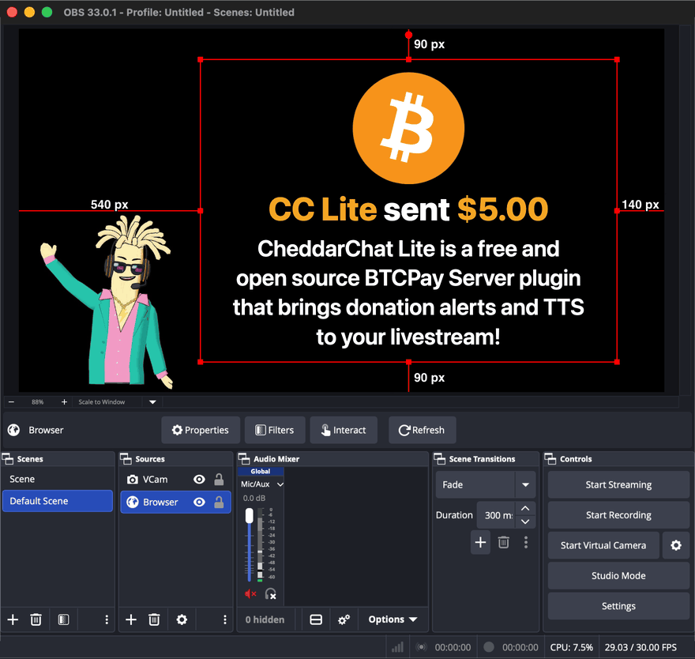
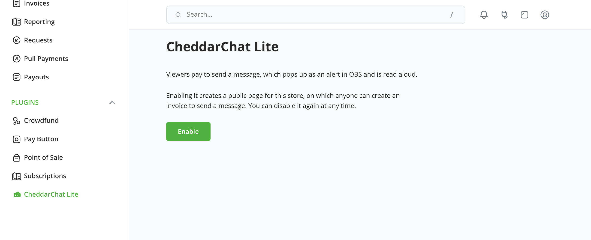
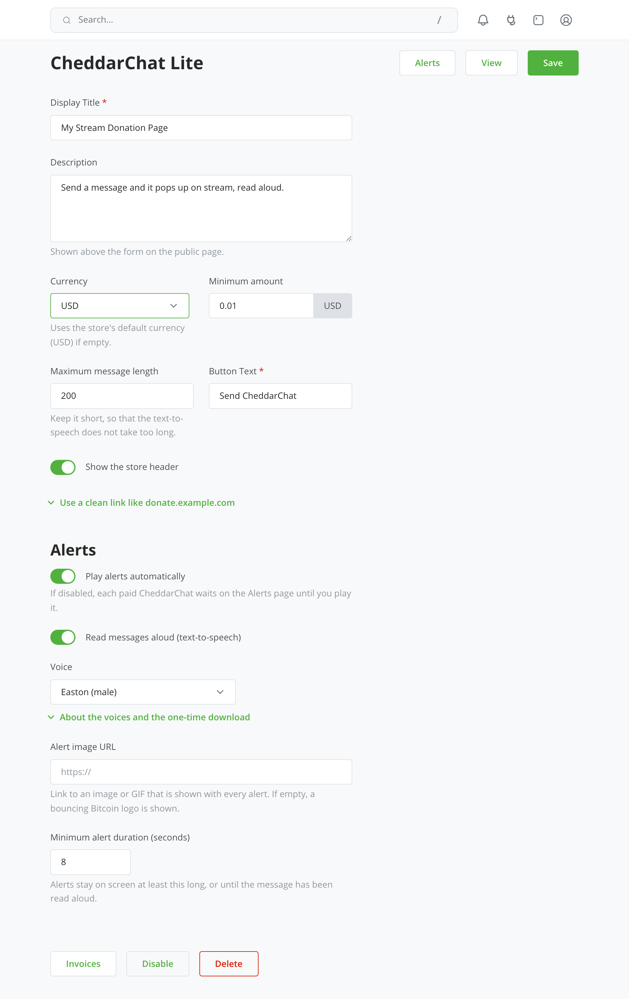
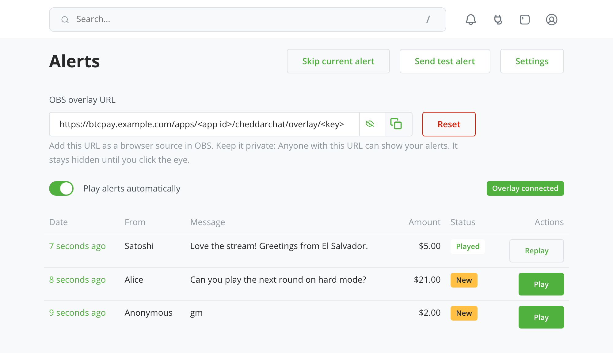
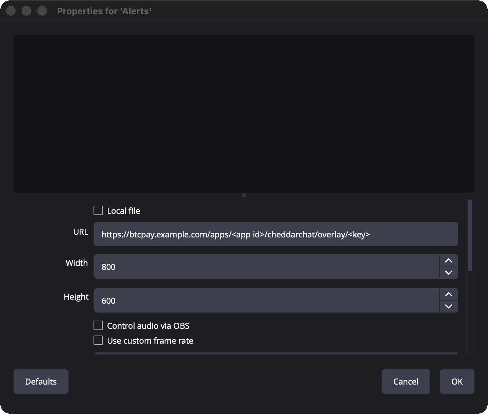
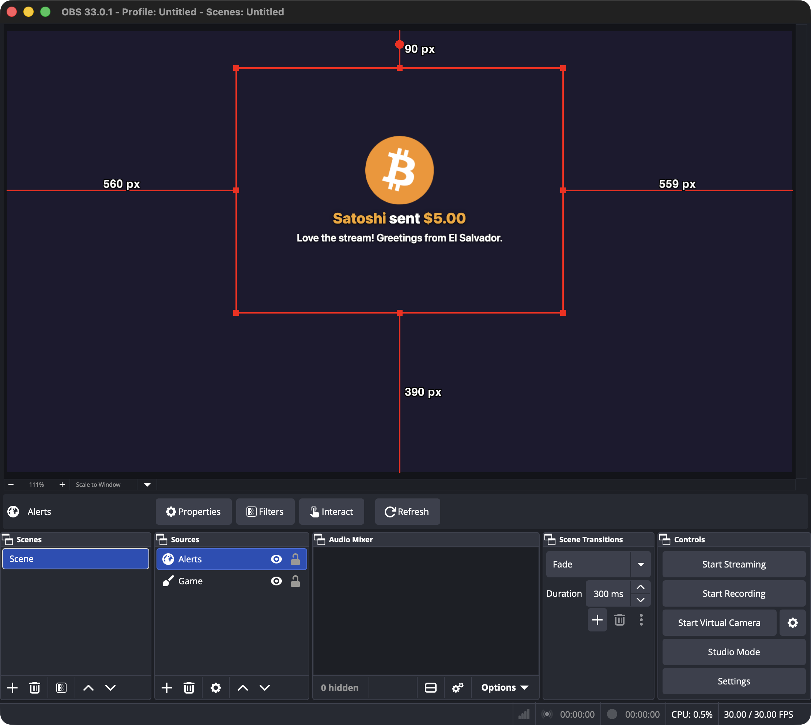
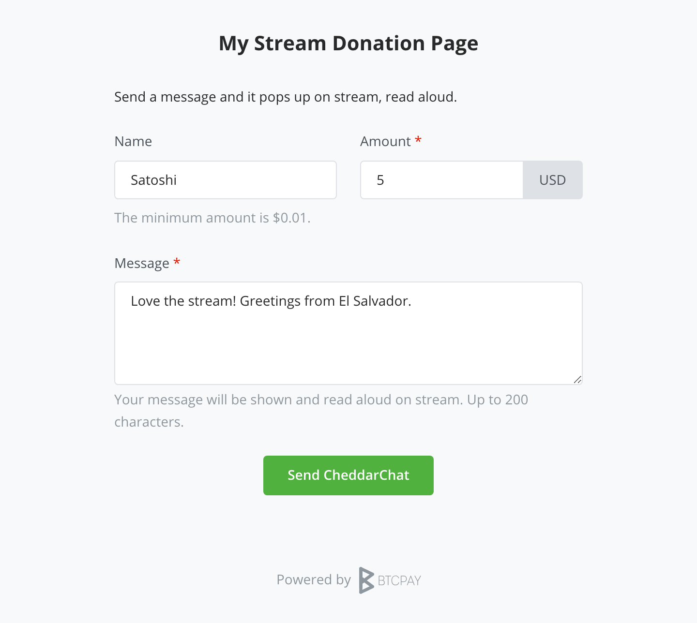

# CheddarChat Lite

A free, minimal [BTCPay Server](https://github.com/btcpayserver/btcpayserver) plugin for streamers. Viewers pay to send a message, and once the payment is settled it pops up as an alert in OBS and is read aloud.



## Getting started

You need BTCPay Server 2.4.7 or newer with the plugin installed (see [Building](#building)), and OBS.

### 1. Enable it for your store

In the left navigation of your store, click **CheddarChat Lite**, then **Enable**. Each store has one CheddarChat.



### 2. Choose your settings

Set the title and description of your page, the currency and the minimum amount, and pick the voice that reads the messages. Click **Save**.



### 3. Copy the overlay URL

Click **Alerts**, then the copy button next to **OBS overlay URL**. The URL contains a secret key, so it stays hidden until you click the eye, and copying works without showing it. If it ever leaks, click **Reset** and use the new URL in OBS.



### 4. Add the overlay to OBS

In OBS, click **+** under **Sources** and choose **Browser**. Paste the URL, set the width to 800 and the height to 600 (or your full canvas size), and click **OK**.



*The address shown here is an example. Yours is the one you copied from the Alerts page.*

The first time, OBS downloads the voice (about 70 MB) and the overlay shows a progress bar in its bottom left corner, so do this before you go live.

### 5. Place it and send a test alert

Alerts appear inside the red box of the source: drag it to where you want them. Then click **Send test alert** on the Alerts page.



### 6. Share your page

Click **View** in the settings to open your public page, and share its link with your viewers.



<details>
<summary><strong>Use a clean link like donate.example.com</strong></summary>

The public page is at `https://your-btcpay-server/apps/<app id>/cheddarchat`. BTCPay Server can show it on a subdomain of a domain you own instead, for example `donate.example.com`. The admin of the server sets this up: see [How to map a domain name to an app](https://docs.btcpayserver.org/FAQ/Apps/#how-to-map-a-domain-name-to-an-app) in the BTCPay Server documentation.

The last step there asks for the app: enter the app id, which the settings show under **Use a clean link like donate.example.com**. Afterwards the old link forwards to the subdomain, and the OBS overlay URL stays as it is.

</details>

## Automatic or manual alerts

- **Automatic** (default): Paid CheddarChats play as soon as they settle. Use **Skip current alert** to cut one short.
- **Manual:** Paid CheddarChats are listed as **New** on the Alerts page and only play when you click **Play**.

A CheddarChat counts as played once it has been sent to a connected overlay. If no overlay is connected when it settles, it stays **New**, so you can play it later.

## Turning it off

- **Disable** in the settings turns off the public page and the overlay. The settings and both URLs are kept, and **Enable** brings them back.
- **Delete** removes the settings and both URLs for good. Enabling CheddarChat Lite again starts fresh, with new URLs.

## What the overlay loads from other servers

Only the overlay page does this, and only when a named voice is selected. The public donation page and the admin pages load nothing from outside your BTCPay Server.

| What | From | Size |
|---|---|---|
| Phonon runtime `phonon-tts` 0.7.1 (MIT or Apache-2.0) | cdn.jsdelivr.net | about 4 MB |
| Phonon 31m English model and the selected voice (Apache-2.0) | huggingface.co | about 65 MB |

Versions are pinned, so these addresses always return the same files. The requests come from the streamer's OBS, never from viewers.

## Customizing the look

The overlay uses the store's brand color (Store Settings → Branding) for the name and amount. Everything else can be changed in the browser source's **Custom CSS** field in OBS, for example:

```css
:root {
  --cc-accent: #ff4f9a;
  --cc-text: #fff;
  --cc-font: "Comic Sans MS", cursive;
}
.cc-alert { justify-content: flex-end; }   /* alerts at the bottom */
.cc-alert__image { max-height: 30vh; }
.cc-alert__image--default { animation: none; }   /* Bitcoin logo without the bounce */
```

Available classes: `.cc-alert`, `.cc-alert__image`, `.cc-alert__image--default` (the Bitcoin logo that is shown when no alert image is set), `.cc-alert__title`, `.cc-alert__name`, `.cc-alert__amount`, `.cc-alert__message`.

## Building

This repository uses BTCPay Server as a Git submodule, pinned to v2.4.7, the minimum version the plugin supports.

```sh
git submodule update --init --recursive
dotnet build BTCPayServer.Plugins.CheddarChatLite
```

To create an installable package (`.btcpay`) that you can upload under Server Settings → Plugins:

```sh
dotnet publish BTCPayServer.Plugins.CheddarChatLite -c Release -o publish
dotnet run --project btcpayserver/BTCPayServer.PluginPacker -- publish BTCPayServer.Plugins.CheddarChatLite dist
```

### Running it in a BTCPay development environment

Start the dependencies from `btcpayserver/BTCPayServer.Tests` (`docker compose up dev`), then point BTCPay Server at the debug build in `btcpayserver/BTCPayServer/appsettings.dev.json`:

```json
{
  "DEBUG_PLUGINS": "/absolute/path/to/BTCPayServer.Plugins.CheddarChatLite/bin/Debug/net10.0/BTCPayServer.Plugins.CheddarChatLite.dll"
}
```

## License

[MIT](LICENSE), copyright CheddarChat LLC.

## Credits

Based on the [Shoutout plugin](https://github.com/dennisreimann/btcpayserver-plugin-shoutout) by Dennis Reimann (MIT), see [NOTICE.md](NOTICE.md).
